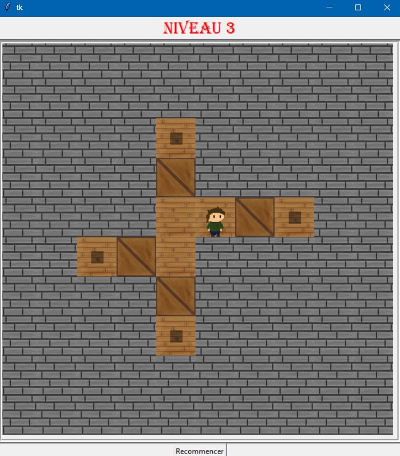
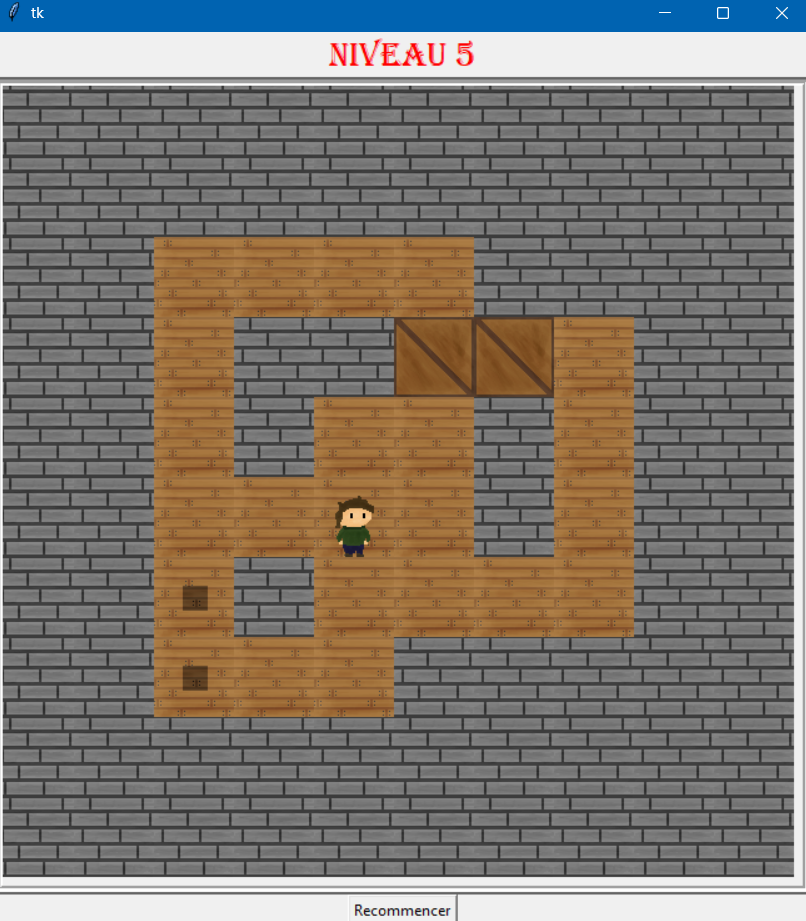

# Sokonsi
Puzzle game where you have to push crates onto specific target locations.

Movement controls: Z, Q, S, D (if you're using a QWERTY keyboard, switch your keyboard layout to AZERTY and use W, A, S, D).

Possibility to add level in `SauvegardeCarte.txt`:
- `X`: wall
- `C`: crates
- `P`: player
- `A`: arrival slot of crate
- `T`: teleporter (0 or 2 only per level, only player can use it - not crate)

An old project made in high school using Python and Tkinter.

